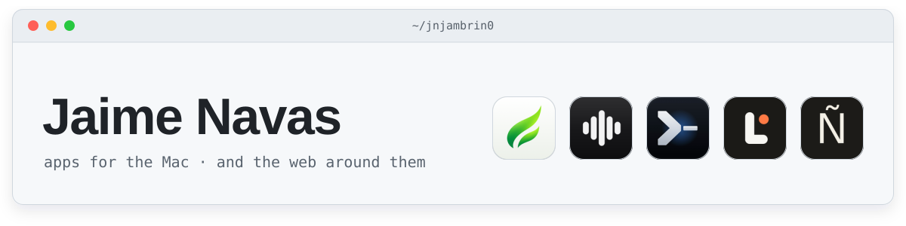
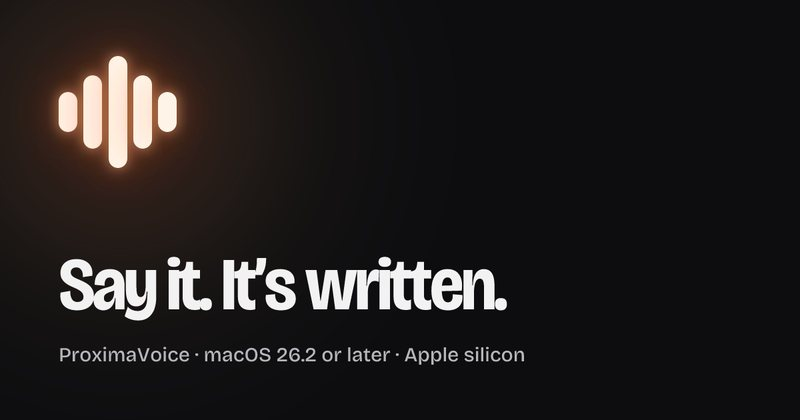
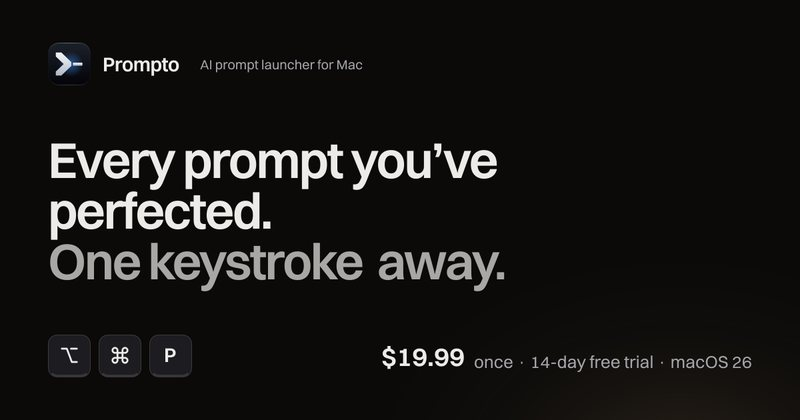
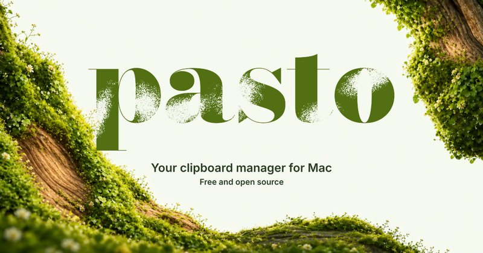
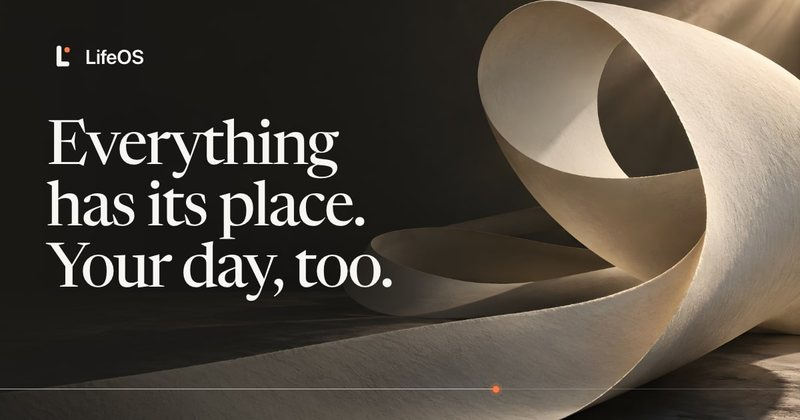

<a href="https://jnjambrino.com">
  <picture>
    <source media="(prefers-color-scheme: dark)" srcset="assets/banner-dark.svg">
    <source media="(prefers-color-scheme: light)" srcset="assets/banner-light.svg">
    
  </picture>
</a>

I build software, ML/DL models and AI apps: native Mac apps in Swift, the websites and backends around them, and models like graph neural networks for intrusion detection. Based in Madrid.

### Apps

<table>
  <tr>
    <td width="50%" valign="top">
      
       <b><a href="https://www.proximavoice.com">ProximaVoice</a></b> 
      Dictation for the Mac that writes in any app. Transcribed on your Mac, with no word limit.
    </td>
    <td width="50%" valign="top">
      
       <b><a href="https://prompto.jnjambrino.com">Prompto</a></b> 
      A launcher for your reusable AI prompts. Press <kbd>⌥</kbd><kbd>⌘</kbd><kbd>P</kbd> in any app, fill in the blanks, paste.
    </td>
  </tr>
  <tr>
    <td width="50%" valign="top">
      
       <b><a href="https://pasto.jnjambrino.com">Pasto</a></b> · <a href="https://github.com/jnjambrin0/Pasto">source</a> 
      A free, open-source clipboard manager. Everything you copy, one shortcut away.
    </td>
    <td width="50%" valign="top">
      
       <b><a href="https://life-os.jnjambrino.com">LifeOS</a></b> 
      Your day, your projects and everything you write. Jot it down in one sentence, find it where you left it.
    </td>
  </tr>
</table>

### Open source

- **[Pasto](https://github.com/jnjambrin0/Pasto)**: clipboard manager for macOS. Swift 6, MIT, signed, notarised and self-updating.
- **[PromptImprover](https://github.com/jnjambrin0/PromptImprover)**: macOS app that improves prompts locally through the `codex` and `claude` CLIs, with strict output validation.
- **[LocalChessEngine](https://github.com/jnjambrin0/Master-Chess)**: C++23 UCI chess engine with a Qt desktop GUI and a PyTorch NNUE trainer.
- **[Next-Gen Image Converter](https://github.com/jnjambrin0/Next-Gen-Image-Format-Converter-Optimizer)**: local-first image conversion and optimisation, with a web UI, a CLI and a REST API.
- **[HuntEX](https://github.com/jnjambrin0/huntex-app)**: exoplanet classifier for Kepler KOI data, built for the NASA Space Apps Challenge. [Live demo](https://huntex-app.vercel.app).
- **[HAGNN Benchmark](https://github.com/jnjambrin0/Benchmark-TFG)**: reproducible benchmark of MLP, GATv2 and a hyperbolic GNN (HAGNN) for multiclass network intrusion detection on CSE-CIC-IDS2018.

Also on the web: **[Trama](https://crucigramas-sigma.vercel.app)**, daily crosswords in Spanish with no sign-up and no ads.

<samp><a href="https://jnjambrino.com">jnjambrino.com</a></samp>
